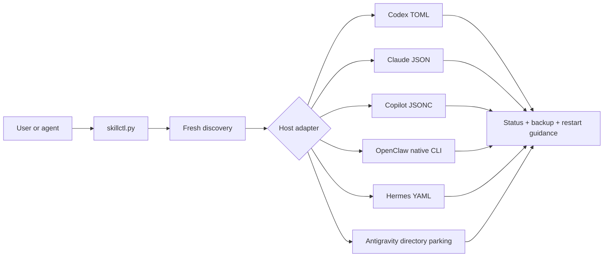

<div align="center">

# Manage Agent Skills

### One safe switchboard for Agent Skills across coding agents

Discover, audit, enable, disable, and preset installed skills without deleting,
renaming, or editing their files — and without running a daemon. On Codex, the
manager reports when host prompt metadata cannot be verified locally.
Antigravity has no native skill switch, so it is the one documented exception:
disabled skill directories are parked, unchanged, in `skills_disabled/`.

Built by [Han (@yunze7373)](https://github.com/yunze7373) ·
[Yonro Co., Ltd.](https://yonro.co.jp)

[](https://github.com/yunze7373/manage-agent-skills/actions/workflows/ci.yml)
[](https://www.python.org/)
[](https://agentskills.io/)
[](#host-platform-support)
[](#operating-system-support)
[](#safety-by-design)
[](LICENSE)

[Quick start](#quick-start) ·
[OS support](#operating-system-support) ·
[Hosts](#host-platform-support) ·
[Safety](#safety-by-design) ·
[Presets](#presets) ·
[Contributing](#contributing)

</div>

---

## 上传到 Claude（claude.ai / Desktop）

当前版本 **v1.2.0**。从 [GitHub Release](https://github.com/yunze7373/manage-agent-skills/releases/tag/v1.2.0)
下载 `manage-agent-skills-v1.2.0.zip`，或在仓库执行：

```text
python scripts/release.py package v1.2.0 --output-dir dist/v1.2.0
```

必须上传 `dist/vX.Y.Z/manage-agent-skills-vX.Y.Z.zip`，保留文件夹结构，
**不能只传 SKILL.md，也不要上传 GitHub 的 Source code ZIP**：

```text
manage-agent-skills/
  SKILL.md
  scripts/skillctl.py
  references/...
```

在 Claude 的 Customize > Skills 中选择 + / Create skill > Upload a skill，上传完整 ZIP。
按账号设置启用代码执行和技能。官方依据（2026-10-25 核对）：
[使用技能](https://support.claude.com/en/articles/12512180-use-skills-in-claude) 与
[创建自定义技能](https://support.claude.com/en/articles/12512198-how-to-create-custom-skills)。
发布校验采用当前帮助文档较严格的描述长度上限 200 字符；scripts 和 references 是本技能的必需文件，
并非所有 Claude 技能都必须有。校验通过说明结构符合这些检查，不等于账号上传已实测成功。

2026-10-25 用户在 Desktop Code 标签页实测：上传后显示为
`anthropic-skills:manage-agent-skills`，与官方技能位于同一个 skills-plugin 缓存。
这是该 Desktop 版本的装载/命名空间行为，**不代表作者是 Anthropic**；作者是 Han / yunze7373。
官方[插件技能文档](https://code.claude.com/docs/en/skills)解释插件命名空间，
当前官方文档已明确将 `anthropic-skills` 保留给 claude.ai 同步技能；私有缓存路径仍不视为稳定接口。

调用时先检查同目录脚本，缺失即提示“安装不完整，请重新上传完整 zip”并停止。
已有旧上传不会自动获得新自检，需在 Claude 中重新上传。运行 `doctor --json` 查看执行器 `version`；
`audit` 比较已发现副本与执行器版本，不联网推断最新版本。claude.ai 云端执行环境不能据此访问本机安装目录。

## 从 manage-codex-skills 迁移

`manage-codex-skills` 是 Codex 专用前身；本技能覆盖其盘点、搜索、启停、分组和预设管理用途。
但不是逐命令无差异替换：旧工具内置的个人 `lean/all` 策略需转为显式 preset JSON，
分组需转为 `--groups` 文件；默认使用路径规则，名称规则兼容模式需核对宿主支持。
不要把旧命令参数直接复制执行。先运行新工具 `--platform codex audit --json`，
核对现有规则，再用相同目标 `--dry-run` 对照。旧工具的管理块继续由已有兼容逻辑处理。

`audit` 将名为 `manage-codex-skills` 的副本标为 `replaceable_legacy_manager`，提示可以迁移；
这不证明本地自定义脚本完全等价。保留旧文件与配置，人工确认自定义预设后再决定停用旧入口。
本次检测不会删除、移动或改写任何已安装技能。

## Why

New in v1.1.1: description search,
bounded ranked results, offline inventory snapshots, activation inspection, and
scoped Gemini CLI/OpenCode adapters. See [implementation and validation](docs/improvements-2026-10-23.md).

Agent Skills are increasingly portable: the same `SKILL.md` can work in
multiple agents. Skill enablement is not portable. Every host discovers skills
from different locations and exposes a different visibility mechanism.

Manage Agent Skills provides one CLI and one reusable Agent Skill over a set of
host-specific adapters:

- files stay installed, unmodified, and updateable;
- unused skills can be removed from a host's active catalog;
- newly installed skills appear on the next invocation;
- every mutation can be previewed with `--dry-run`;
- unrelated host configuration is preserved.

> [!IMPORTANT]
> This project is intentionally on-demand. It does not start a background
> service, watch skill directories, or move/delete installed skills. The single
> exception is the Antigravity adapter, which moves whole skill directories
> between `skills/` and `skills_disabled/` because the host offers no other
> control; it never deletes, overwrites, or edits them.

## Operating system support

The CLI supports Windows, macOS, and Linux with Python 3.11 or newer. Paths are
interpreted using the native rules of the operating system where `skillctl.py`
is running.

| Operating system | Exact-path form | CI |
| --- | --- | :---: |
| Windows | `path:C:\skills\demo\SKILL.md` | ✅ |
| macOS | `path:/Users/alice/.agents/skills/demo/SKILL.md` | ✅ |
| Linux | `path:/home/alice/.agents/skills/demo/SKILL.md` | ✅ |

Use the absolute path reported by `search`. Quote the complete selector when
the path contains spaces. A path from one operating system is not translated
into another operating system's path syntax.

## Host platform support

| Host | Discovery | Native control | Support |
| --- | --- | --- | :---: |
| OpenAI Codex | Shared, Codex, and plugin skill roots | Managed `skills.config` overrides | ✅ |
| Anthropic Claude Code | User and project skill roots | `skillOverrides`, four visibility states | ✅ |
| GitHub Copilot CLI | Native inventory with filesystem fallback | `disabledSkills` | ✅ |
| OpenClaw | Native inventory with workspace/user fallback | `skills.entries.<key>.enabled` through the native CLI | ✅ |
| Hermes Agent | `$HERMES_HOME/skills` | Global or per-platform disable lists | ✅ |
| Antigravity App/IDE or CLI | Surface-specific global root | Manager-owned directory parking | Scoped |
| Gemini CLI | User/workspace `.gemini/skills` and `.agents/skills` | Selected `skills.disabled` settings | Scoped |
| OpenCode | User/project and compatible local roots | Selected `permission.skill` rules | Scoped |
| Claude Desktop / Cowork | Outside local adapter scope | Host UI | Not implemented |

Claude Desktop and Cowork are outside this manager's local adapter scope.
Manage those skill pools in the host UI.

Detailed semantics and primary references live in
[platforms.md](skills/manage-agent-skills/references/platforms.md).

## Quick start

### Windows PowerShell

```powershell
git clone https://github.com/yunze7373/manage-agent-skills.git
Set-Location manage-agent-skills
python -m pip install -r requirements.txt

$skillctl = ".\skills\manage-agent-skills\scripts\skillctl.py"
python $skillctl doctor
python $skillctl --platform all status
python $skillctl --platform all search azure
```

### macOS or Linux

```bash
git clone https://github.com/yunze7373/manage-agent-skills.git
cd manage-agent-skills
python3 -m pip install -r requirements.txt

skillctl="./skills/manage-agent-skills/scripts/skillctl.py"
python3 "$skillctl" doctor
python3 "$skillctl" --platform all status
python3 "$skillctl" --platform all search azure
```

Preview a change, then apply the same command without `--dry-run`:

```powershell
python $skillctl --platform codex disable azure-cost --dry-run
python $skillctl --platform codex disable azure-cost
```

Mutations require one explicit platform. Partial-name mutation is deliberately
rejected; use an exact name, exact group, exact path, or `all`.

## Install as an Agent Skill

The portable skill package is
[`skills/manage-agent-skills`](skills/manage-agent-skills). Link or copy that
directory into a skill root supported by your agent:

| Host | Typical user skill root |
| --- | --- |
| Codex / Copilot CLI / OpenClaw | `~/.agents/skills` |
| Claude Code | `~/.claude/skills` |
| Hermes Agent | `$HERMES_HOME/skills` |
| Antigravity App/IDE | `~/.gemini/config/skills` |
| Antigravity CLI | `~/.gemini/antigravity-cli/skills` |

Keeping a symbolic link to the clone makes future updates immediate. You can
also run the Python CLI directly without installing the Agent Skill.

## Commands

```text
doctor
status
audit [--strict]                # Read-only metadata and compatibility findings
search QUERY
index --output FILE            # Private, dated metadata snapshot
inspect SELECTOR...            # Read-only activation preview and refresh guidance
enable SELECTOR...
disable SELECTOR...
reconcile                         # Codex: normalize stable configuration rules
set STATE SELECTOR...          # Claude Code only
preset NAME --file FILE
```

### JSON output

Pass `--json` before or after any command when a script needs structured
output. Both forms are equivalent:

```text
python <skillctl> --platform all --json status
python <skillctl> --platform all status --json
```

### Find and activate expertise on demand

Search includes descriptions and disabled skills. Space-separated words must
all match; exact names rank first. This is lexical retrieval, not semantic search.
The default maximum is 20 results; `--limit 0` explicitly requests all results.

```text
python <skillctl> --platform all search "invoice" --limit 5 --report --json
python <skillctl> --platform all search "发票" --aliases search-aliases.example.json --report --json
python <skillctl> --platform codex inspect exact-skill-name --json
python <skillctl> --platform codex enable exact-skill-name --dry-run
python <skillctl> --platform codex enable exact-skill-name
```

`inspect` performs no writes. It previews activation, lists known extra settings
layers, and gives host refresh instructions. A disabled Codex parent plugin now
returns a structured blocker and nonzero exit without changing skill rules.
Refresh and verify in the host before claiming that a configured skill is usable.
The manager never starts a model session or restarts your host automatically.

For repeated low-latency lookup, export a private snapshot to a **new** path:

```text
python <skillctl> --platform all index --output catalog.skill-index.json
python <skillctl> search "invoice" --index catalog.skill-index.json --limit 5 --report --json
```

Offline searches invoke no host CLIs. Snapshots include generation time, paths,
descriptions, disabled entries and any discovery errors. They do not update
automatically; create a fresh snapshot after installing/updating skills. Mutation
commands always rescan and do not accept `--index`. Keep snapshots private.

One broken adapter no longer discards healthy search results. Partial results
return exit code 1. `--report --json` returns a results/errors/total envelope;
legacy `search --json` retains its array, with diagnostics on stderr. Results
are bounded to reduce tool-output size; this is not measured model-token savings.

### Gemini CLI and OpenCode

```text
python <skillctl> --platform gemini --gemini-scope workspace disable demo --dry-run
python <skillctl> --platform opencode --opencode-config /absolute/opencode.jsonc enable demo --dry-run
```

Gemini uses `skills.disabled` in user settings by default; workspace scope uses
`<cwd>/.gemini/settings.json`. `GEMINI_CLI_HOME` relocates its user home. OpenCode
uses exact `permission.skill` allow/deny rules, preserving wildcard order and
unrelated permission settings. `OPENCODE_CONFIG` and `XDG_CONFIG_HOME` are honored;
JSONC requires explicit file selection. Both adapters cover local roots and one
settings layer, not all extensions, managed settings or effective live policies.

### Audit and compatibility

```text
python <skillctl> --platform all audit --json
python <skillctl> --platform codex audit --strict
```

Audits report malformed metadata, duplicate identities, unresolved state,
additional configuration layers and host limitations. They never claim actual
model token savings. `status` and `doctor` isolate adapter failures and return
nonzero if discovery is incomplete. Unknown mutation names fail unless the
caller explicitly uses `--allow-undiscovered` on Copilot/OpenClaw/Hermes.

Read [audit and recovery](skills/manage-agent-skills/references/auditing.md) for
exit codes and recovery boundaries, and the
[2026-10-21 upgrade report](docs/audit-2026-10-21.md) for findings and validation.

### Selectors

| Selector | Example | Meaning |
| --- | --- | --- |
| Exact name | `openai-docs` | Every discovered item with that host-scoped name or identifier |
| Group | `group:claude-user` | Every skill in one group |
| Exact path | `path:<native-absolute-path>` | One installed skill path |
| All | `all` | Every discovered skill on the selected host |

### Groups

By default a group is only **where a skill was discovered** — `shared`,
`claude-user`, `codex-project`, a plugin name, and so on. No skill is grouped
by its name out of the box, because any such taxonomy is specific to one
person's machine.

To define your own, pass a JSON file with a `groups` section. Patterns are
`fnmatch` style and match the display name, the host identifier, or the
directory name, case-insensitively:

```json
{ "version": 1, "groups": { "azure": ["azure-*", "entra-*"] } }
```

```powershell
python $skillctl --platform codex --groups my-groups.json disable group:azure --dry-run
```

A preset file may carry the same `groups` section, so one file can serve both
`--groups` and `--file`.

Exact-path examples:

```text
Windows: path:C:\skills\demo\SKILL.md
macOS:   path:/Users/alice/.agents/skills/demo/SKILL.md
Linux:   path:/home/alice/.agents/skills/demo/SKILL.md
```

For example, quote a selector containing spaces:

```powershell
python $skillctl --platform codex disable 'path:C:\Agent Skills\demo\SKILL.md' --dry-run
```

```bash
python3 "$skillctl" --platform codex disable 'path:/home/alice/Agent Skills/demo/SKILL.md' --dry-run
```

`manage-agent-skills`, `skill-creator`, and `plugin-creator` are protected from
bulk disable operations unless `--force` is explicitly supplied.

## Common workflows

### Codex

```powershell
python $skillctl --platform codex status
python $skillctl --platform codex disable group:azure --dry-run
python $skillctl --platform codex reconcile --dry-run
python $skillctl --platform codex reconcile
```

Codex defaults to documented path-based `skills.config` rules and leaves skill
files untouched. Existing name rules are preserved. Use `--codex-selector name`
only after verifying that the exact host build supports that contract. In this
explicit mode, `reconcile` can migrate old plugin paths into stable names;
default reconciliation preserves paths. Re-scan after plugin updates because
path rules can reference obsolete versions.

`status` reports metadata context as `context-unverified`. Plugin cache and
selected configuration do not prove the host's actual prompt contents. Run
`audit` to find duplicate identities, host-dependent rules and other limitations.

### Claude Code

```powershell
python $skillctl --platform claude disable legacy-context --dry-run
python $skillctl --platform claude enable legacy-context
```

Claude Code has four visibility states, reachable with `set`:

| State | Listed to Claude | In `/` menu |
| --- | --- | --- |
| `on` | Name and description | Yes |
| `name-only` | Name only | Yes |
| `user-invocable-only` | Hidden | Yes |
| `off` | Hidden | Hidden |

```powershell
# Cut idle context but keep the skill discoverable and invocable
python $skillctl --platform claude set name-only legacy-context

# Keep it manually callable, out of automatic model discovery
python $skillctl --platform claude set user-invocable-only deploy
```

Claude Code keys personal and project skills by **directory name**. The
frontmatter `name` is only a display label, so a skill in
`~/.claude/skills/memory-manager/` with `name: Memory Manager` is keyed
`memory-manager`. `search` prints the identifier as `(key=...)` whenever the
two differ, and mutations report `display_name_differs`.

Two current limits: the adapter reads and writes `~/.claude/settings.json`
only, so a project-level `.claude/settings.local.json` entry can override the
result; and plugin and bundled skills are not discovered — manage those with
`/plugin` and `disableBundledSkills`.

### GitHub Copilot CLI

```powershell
python $skillctl --platform copilot disable unused-skill --dry-run
```

### OpenClaw

```powershell
python $skillctl --platform openclaw disable browser-tools --dry-run
```

OpenClaw mutations are delegated to `openclaw config set`; the manager does not
rewrite its JSON5 configuration. Agent-level allowlists can still narrow the
final visible set.

### Hermes Agent

```powershell
# Global
python $skillctl --platform hermes disable shell-tools --dry-run

# Only on Telegram
python $skillctl --platform hermes --hermes-scope telegram disable shell-tools --dry-run
```

Hermes global disables take precedence over platform-specific state.

### Antigravity / agy CLI

```powershell
python $skillctl --platform antigravity status
python $skillctl --platform antigravity disable bigquery-sql gcp-spark --dry-run
python $skillctl --platform antigravity enable gcp-spark
```

The default `--antigravity-surface app` manages `~/.gemini/config/skills`.
Use `--antigravity-surface cli` for the current CLI's
`~/.gemini/antigravity-cli/skills`. `--antigravity-config` or
`ANTIGRAVITY_CONFIG_HOME` overrides either selection for known custom/legacy roots.

`disable` parks the whole directory under sibling `skills_disabled`; `enable`
restores it. The preview reports exact moves. Collisions and redirected roots
are refused. Failed batches attempt rollback and report incomplete recovery.
Workspace and plugin copies remain outside scope, so location is not proof
of prompt visibility. Gemini CLI is a separate host, not this adapter.

## Presets

Presets make repeatable profiles such as `lean`, `coding`, or `research`
portable:

```powershell
python $skillctl --platform codex preset lean --file skill-presets.example.json --dry-run
```

The format supports per-platform `disable` and `enable` selectors. Explicit enables win without a transient disable. All actions are preflighted
before writes; runtime failures can still leave partial changes. See
[presets.md](skills/manage-agent-skills/references/presets.md).

## How it works



The portable interface is shared; discovery and mutation remain host-specific.
That separation prevents the manager from pretending different agents have
identical lifecycle semantics.

## Safety by design

- **Non-destructive:** no installed skill directory or `SKILL.md` is deleted or
  edited; Antigravity alone moves whole directories between managed roots.
- **On-demand:** no daemon, scheduled task, or manager-owned watcher.
- **Previewable:** every mutation supports `--dry-run`.
- **Scoped:** mutations require one explicit platform.
- **Recoverable:** file-backed configuration gets a sibling
  `.manage-agent-skills.bak` before modification, with unique suffixes on later
  backups so earlier recovery copies survive.
- **Atomic where owned:** direct config writes use an atomic replacement.
- **Native where safer:** OpenClaw configuration changes use its own CLI.
- **Conservative:** malformed configuration causes a refusal instead of a
  best-effort rewrite.

Review [SECURITY.md](SECURITY.md) before reporting a vulnerability or using
third-party skills.

## Requirements

- Python 3.11 or newer
- PyYAML 6.0 or newer for bounded YAML metadata parsing and Hermes configuration
- The relevant host CLI/configuration for the platform being managed

Metadata parsing uses PyYAML safe loading; skill instructions and scripts are
never executed during inventory or audit.

## Development

```text
python -m pip install -r requirements.txt
python -m unittest discover -s tests -v
python -m py_compile skills/manage-agent-skills/scripts/skillctl.py scripts/release.py
```

Validate the packaged skill when the OpenAI skill-creator utilities are
available:

```text
python <path-to-skill-creator>/scripts/quick_validate.py skills/manage-agent-skills
```

The CI workflow runs the test suite on Linux, Windows, and macOS.

## Releases

A pushed stable tag (`vMAJOR.MINOR.PATCH`) runs the release workflow. It checks
that the tag, `SKILL.md` metadata and CLI version agree, runs the existing
cross-platform manager tests, then creates a GitHub Release with a deterministic
ZIP and `SHA256SUMS`. The ZIP contains the installable skill, its license, and
its Python dependency file.

Both registry jobs run automatically after the GitHub Release job succeeds.
They run independently: a scan delay on ClawHub does not prevent SkillHub
submission. Missing credentials fail the channel job instead of silently skipping it.

- ClawHub target: `yunze7373/manage-agent-skills`; repository secret `CLAWHUB_TOKEN`.
- SkillHub target: `https://skillhub.cn/skills/indiv-xmemo/manage-agent-skills`;
  repository secret `SKILLHUB_KEY` for its current owner `user_aad66cab`.
  This uses the official skillhub.cn CLI and `https://api.skillhub.cn`, not
  the unrelated xfyun registry. GitHub secrets cannot be copied out of another
  repository; provision the key directly into this repository.

The SkillHub flow follows memory-os-cli's XMemo release: download the GitHub
Release archive, verify SHA-256, and add platform frontmatter only to the
extracted SKILL.md. The SkillHub API rejects extensionless filenames, so the
root `LICENSE` file is omitted from this channel's payload; the package still
declares `MIT` in its SkillHub metadata. Every retained file other than
SKILL.md remains byte-identical. The official CLI archive is hash-pinned; when
its upstream `latest.tar.gz` changes, review the new CLI and update the checksum
in the workflow before releasing.

Both channels preview publication, check existing versions, and verify file
hashes. SkillHub additionally verifies the credential owns the existing
namespace. Its publish API can accept a version while platform review is still
pending; in that state the workflow verifies the exact archive, reports that the
public latest pointer has not advanced, and will not submit that version again.
Once the platform promotes it, a rerun verifies it as public latest. ClawHub
scan-report availability alone is not a final verdict: its post-publish check
waits up to 30 minutes for public visibility, and a retry refuses to re-upload a
previously submitted hidden version.

If the SkillHub job fails after the GitHub Release exists, use the manual
`Publish SkillHub version` workflow with the existing release tag. It checks that
the current source version matches that tag and republishes only from the
immutable GitHub Release assets.

As of 2026-10-21, the latest shared release is `1.0.1` across the source,
GitHub, ClawHub, and SkillHub. For each future release, choose a version higher
than SkillHub's current latest and use the same value for `SKILL.md`, the CLI,
Git tag, GitHub Release, ClawHub, and SkillHub. Do not push the existing
`0.2.1` tag again.
The `PUBLISH_TO_*` variables and `SKILLHUB_NAMESPACE`/`SKILLHUB_TOKEN` configuration
from the old workflow are no longer used. SkillHub CLI reads `SKILLHUB_TOKEN`
only inside the publish step, where it is mapped from the `SKILLHUB_KEY` secret.

For a new version, update both `metadata.version` in
`skills/manage-agent-skills/SKILL.md` and `VERSION` in `skillctl.py`, merge the
change, then push its matching tag. The workflow applies to newly pushed tags;
it does not back-publish existing releases. This project is not an npm package,
so npm publishing is not part of the release pipeline.

## Contributing

Issues and pull requests are welcome. New
adapters must:

1. document the host's current primary source;
2. implement discovery and `--dry-run` before mutation;
3. preserve unrelated configuration and create recoverable backups;
4. avoid deleting installed skills and explicitly document any scoped relocation;
5. include isolated tests that never touch real user settings.

See [CONTRIBUTING.md](CONTRIBUTING.md) for the full checklist.

## Project status

The source version is **v1.1.1**. See GitHub Releases and the registry pages for publication status.
Check the CLI with `python <skillctl> --version`.
The public API, preset schema, and supported host versions may evolve over time.

## License

Released under the [MIT License](LICENSE). Copyright © 2026 yunze7373.


## 平台适配与自适应扩展

技能入口只保留通用流程。Agent 先区分执行宿主、运行位置和管理目标，
再按索引读取 `references/adapters/<platform>.md`；用户指定的目标优先。
模型品牌、安装目录或存在某个 CLI 都不能独自证明当前宿主身份。

```text
python skills/manage-agent-skills/scripts/skillctl.py adapter-guide --json
python skills/manage-agent-skills/scripts/skillctl.py adapter-guide gemini --json
python skills/manage-agent-skills/scripts/skillctl.py adapter-guide new-host --json
```

该命令不扫描用户配置。已支持的平台返回专属指南；未知平台返回
[添加平台向导](skills/manage-agent-skills/references/add-platform.md)。
任何具备编辑和测试能力的 agent 都可以按向导调研官方契约，在开发副本中添加
自己的 Python Adapter、CLI 注册、平台指南及隔离测试。没有原生启停能力的平台
先提供只读支持，不伪造开关。不具备开发工具的 agent 应提供明确的实现计划与限制。

这项自适应能力是有验证流程的源码扩展，不是运行时自动下载代码、猜测配置或
改写已安装技能。新增指南本身不代表已完成支持；发布和安装沿用各自的授权与校验流程。
