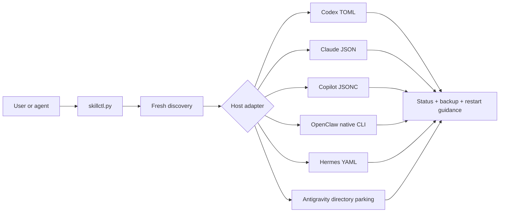

<div align="center">

# Manage Agent Skills

### One safe switchboard for Agent Skills across coding agents

Discover, audit, enable, disable, and preset installed skills without deleting,
renaming, or editing their files — and without running a daemon. On Codex, the
manager reports when host prompt metadata cannot be verified locally.
Antigravity has no native skill switch, so it is the one documented exception:
disabled skill directories are parked, unchanged, in `skills_disabled/`.

Built by [Han (@yunze7373)](https://github.com/yunze7373) ·
[Yonro Co., Ltd.](https://yonro.co.jp)

[](https://github.com/yunze7373/manage-agent-skills/actions/workflows/ci.yml)
[](https://www.python.org/)
[](https://agentskills.io/)
[](#host-platform-support)
[](#operating-system-support)
[](#safety-by-design)
[](LICENSE)

[Quick start](#quick-start) ·
[OS support](#operating-system-support) ·
[Hosts](#host-platform-support) ·
[Safety](#safety-by-design) ·
[Presets](#presets) ·
[Contributing](#contributing)

</div>

---

## Why

Agent Skills are increasingly portable: the same `SKILL.md` can work in
multiple agents. Skill enablement is not portable. Every host discovers skills
from different locations and exposes a different visibility mechanism.

Manage Agent Skills provides one CLI and one reusable Agent Skill over a set of
host-specific adapters:

- files stay installed, unmodified, and updateable;
- unused skills can be removed from a host's active catalog;
- newly installed skills appear on the next invocation;
- every mutation can be previewed with `--dry-run`;
- unrelated host configuration is preserved.

> [!IMPORTANT]
> This project is intentionally on-demand. It does not start a background
> service, watch skill directories, or move/delete installed skills. The single
> exception is the Antigravity adapter, which moves whole skill directories
> between `skills/` and `skills_disabled/` because the host offers no other
> control; it never deletes, overwrites, or edits them.

## Operating system support

The CLI supports Windows, macOS, and Linux with Python 3.11 or newer. Paths are
interpreted using the native rules of the operating system where `skillctl.py`
is running.

| Operating system | Exact-path form | CI |
| --- | --- | :---: |
| Windows | `path:C:\skills\demo\SKILL.md` | ✅ |
| macOS | `path:/Users/alice/.agents/skills/demo/SKILL.md` | ✅ |
| Linux | `path:/home/alice/.agents/skills/demo/SKILL.md` | ✅ |

Use the absolute path reported by `search`. Quote the complete selector when
the path contains spaces. A path from one operating system is not translated
into another operating system's path syntax.

## Host platform support

| Host | Discovery | Native control | Support |
| --- | --- | --- | :---: |
| OpenAI Codex | Shared, Codex, and plugin skill roots | Managed `skills.config` overrides | ✅ |
| Anthropic Claude Code | User and project skill roots | `skillOverrides`, four visibility states | ✅ |
| GitHub Copilot CLI | Native inventory with filesystem fallback | `disabledSkills` | ✅ |
| OpenClaw | Native inventory with workspace/user fallback | `skills.entries.<key>.enabled` through the native CLI | ✅ |
| Hermes Agent | `$HERMES_HOME/skills` | Global or per-platform disable lists | ✅ |
| Antigravity App/IDE or CLI | Surface-specific global root | Manager-owned directory parking | Scoped |
| Claude Desktop / Cowork | Outside local adapter scope | Host UI | Not implemented |

Claude Desktop and Cowork are outside this manager's local adapter scope.
Manage those skill pools in the host UI.

Detailed semantics and primary references live in
[platforms.md](skills/manage-agent-skills/references/platforms.md).

## Quick start

### Windows PowerShell

```powershell
git clone https://github.com/yunze7373/manage-agent-skills.git
Set-Location manage-agent-skills
python -m pip install -r requirements.txt

$skillctl = ".\skills\manage-agent-skills\scripts\skillctl.py"
python $skillctl doctor
python $skillctl --platform all status
python $skillctl --platform all search azure
```

### macOS or Linux

```bash
git clone https://github.com/yunze7373/manage-agent-skills.git
cd manage-agent-skills
python3 -m pip install -r requirements.txt

skillctl="./skills/manage-agent-skills/scripts/skillctl.py"
python3 "$skillctl" doctor
python3 "$skillctl" --platform all status
python3 "$skillctl" --platform all search azure
```

Preview a change, then apply the same command without `--dry-run`:

```powershell
python $skillctl --platform codex disable azure-cost --dry-run
python $skillctl --platform codex disable azure-cost
```

Mutations require one explicit platform. Partial-name mutation is deliberately
rejected; use an exact name, exact group, exact path, or `all`.

## Install as an Agent Skill

The portable skill package is
[`skills/manage-agent-skills`](skills/manage-agent-skills). Link or copy that
directory into a skill root supported by your agent:

| Host | Typical user skill root |
| --- | --- |
| Codex / Copilot CLI / OpenClaw | `~/.agents/skills` |
| Claude Code | `~/.claude/skills` |
| Hermes Agent | `$HERMES_HOME/skills` |
| Antigravity App/IDE | `~/.gemini/config/skills` |
| Antigravity CLI | `~/.gemini/antigravity-cli/skills` |

Keeping a symbolic link to the clone makes future updates immediate. You can
also run the Python CLI directly without installing the Agent Skill.

## Commands

```text
doctor
status
audit [--strict]                # Read-only metadata and compatibility findings
search QUERY
enable SELECTOR...
disable SELECTOR...
reconcile                         # Codex: normalize stable configuration rules
set STATE SELECTOR...          # Claude Code only
preset NAME --file FILE
```

### JSON output

Pass `--json` before or after any command when a script needs structured
output. Both forms are equivalent:

```text
python <skillctl> --platform all --json status
python <skillctl> --platform all status --json
```

### Audit and compatibility

```text
python <skillctl> --platform all audit --json
python <skillctl> --platform codex audit --strict
```

Audits report malformed metadata, duplicate identities, unresolved state,
additional configuration layers and host limitations. They never claim actual
model token savings. `status` and `doctor` isolate adapter failures and return
nonzero if discovery is incomplete. Unknown mutation names fail unless the
caller explicitly uses `--allow-undiscovered` on Copilot/OpenClaw/Hermes.

Read [audit and recovery](skills/manage-agent-skills/references/auditing.md) for
exit codes and recovery boundaries, and the
[2026-10-21 upgrade report](docs/audit-2026-10-21.md) for findings and validation.

### Selectors

| Selector | Example | Meaning |
| --- | --- | --- |
| Exact name | `openai-docs` | Every discovered item with that host-scoped name or identifier |
| Group | `group:claude-user` | Every skill in one group |
| Exact path | `path:<native-absolute-path>` | One installed skill path |
| All | `all` | Every discovered skill on the selected host |

### Groups

By default a group is only **where a skill was discovered** — `shared`,
`claude-user`, `codex-project`, a plugin name, and so on. No skill is grouped
by its name out of the box, because any such taxonomy is specific to one
person's machine.

To define your own, pass a JSON file with a `groups` section. Patterns are
`fnmatch` style and match the display name, the host identifier, or the
directory name, case-insensitively:

```json
{ "version": 1, "groups": { "azure": ["azure-*", "entra-*"] } }
```

```powershell
python $skillctl --platform codex --groups my-groups.json disable group:azure --dry-run
```

A preset file may carry the same `groups` section, so one file can serve both
`--groups` and `--file`.

Exact-path examples:

```text
Windows: path:C:\skills\demo\SKILL.md
macOS:   path:/Users/alice/.agents/skills/demo/SKILL.md
Linux:   path:/home/alice/.agents/skills/demo/SKILL.md
```

For example, quote a selector containing spaces:

```powershell
python $skillctl --platform codex disable 'path:C:\Agent Skills\demo\SKILL.md' --dry-run
```

```bash
python3 "$skillctl" --platform codex disable 'path:/home/alice/Agent Skills/demo/SKILL.md' --dry-run
```

`manage-agent-skills`, `skill-creator`, and `plugin-creator` are protected from
bulk disable operations unless `--force` is explicitly supplied.

## Common workflows

### Codex

```powershell
python $skillctl --platform codex status
python $skillctl --platform codex disable group:azure --dry-run
python $skillctl --platform codex reconcile --dry-run
python $skillctl --platform codex reconcile
```

Codex defaults to documented path-based `skills.config` rules and leaves skill
files untouched. Existing name rules are preserved. Use `--codex-selector name`
only after verifying that the exact host build supports that contract. In this
explicit mode, `reconcile` can migrate old plugin paths into stable names;
default reconciliation preserves paths. Re-scan after plugin updates because
path rules can reference obsolete versions.

`status` reports metadata context as `context-unverified`. Plugin cache and
selected configuration do not prove the host's actual prompt contents. Run
`audit` to find duplicate identities, host-dependent rules and other limitations.

### Claude Code

```powershell
python $skillctl --platform claude disable legacy-context --dry-run
python $skillctl --platform claude enable legacy-context
```

Claude Code has four visibility states, reachable with `set`:

| State | Listed to Claude | In `/` menu |
| --- | --- | --- |
| `on` | Name and description | Yes |
| `name-only` | Name only | Yes |
| `user-invocable-only` | Hidden | Yes |
| `off` | Hidden | Hidden |

```powershell
# Cut idle context but keep the skill discoverable and invocable
python $skillctl --platform claude set name-only legacy-context

# Keep it manually callable, out of automatic model discovery
python $skillctl --platform claude set user-invocable-only deploy
```

Claude Code keys personal and project skills by **directory name**. The
frontmatter `name` is only a display label, so a skill in
`~/.claude/skills/memory-manager/` with `name: Memory Manager` is keyed
`memory-manager`. `search` prints the identifier as `(key=...)` whenever the
two differ, and mutations report `display_name_differs`.

Two current limits: the adapter reads and writes `~/.claude/settings.json`
only, so a project-level `.claude/settings.local.json` entry can override the
result; and plugin and bundled skills are not discovered — manage those with
`/plugin` and `disableBundledSkills`.

### GitHub Copilot CLI

```powershell
python $skillctl --platform copilot disable unused-skill --dry-run
```

### OpenClaw

```powershell
python $skillctl --platform openclaw disable browser-tools --dry-run
```

OpenClaw mutations are delegated to `openclaw config set`; the manager does not
rewrite its JSON5 configuration. Agent-level allowlists can still narrow the
final visible set.

### Hermes Agent

```powershell
# Global
python $skillctl --platform hermes disable shell-tools --dry-run

# Only on Telegram
python $skillctl --platform hermes --hermes-scope telegram disable shell-tools --dry-run
```

Hermes global disables take precedence over platform-specific state.

### Antigravity / agy CLI

```powershell
python $skillctl --platform antigravity status
python $skillctl --platform antigravity disable bigquery-sql gcp-spark --dry-run
python $skillctl --platform antigravity enable gcp-spark
```

The default `--antigravity-surface app` manages `~/.gemini/config/skills`.
Use `--antigravity-surface cli` for the current CLI's
`~/.gemini/antigravity-cli/skills`. `--antigravity-config` or
`ANTIGRAVITY_CONFIG_HOME` overrides either selection for known custom/legacy roots.

`disable` parks the whole directory under sibling `skills_disabled`; `enable`
restores it. The preview reports exact moves. Collisions and redirected roots
are refused. Failed batches attempt rollback and report incomplete recovery.
Workspace and plugin copies remain outside scope, so location is not proof
of prompt visibility. Gemini CLI is a separate host, not this adapter.

## Presets

Presets make repeatable profiles such as `lean`, `coding`, or `research`
portable:

```powershell
python $skillctl --platform codex preset lean --file skill-presets.example.json --dry-run
```

The format supports per-platform `disable` and `enable` selectors. Explicit enables win without a transient disable. All actions are preflighted
before writes; runtime failures can still leave partial changes. See
[presets.md](skills/manage-agent-skills/references/presets.md).

## How it works



The portable interface is shared; discovery and mutation remain host-specific.
That separation prevents the manager from pretending different agents have
identical lifecycle semantics.

## Safety by design

- **Non-destructive:** no installed skill directory or `SKILL.md` is deleted or
  edited; Antigravity alone moves whole directories between managed roots.
- **On-demand:** no daemon, scheduled task, or manager-owned watcher.
- **Previewable:** every mutation supports `--dry-run`.
- **Scoped:** mutations require one explicit platform.
- **Recoverable:** file-backed configuration gets a sibling
  `.manage-agent-skills.bak` before modification, with unique suffixes on later
  backups so earlier recovery copies survive.
- **Atomic where owned:** direct config writes use an atomic replacement.
- **Native where safer:** OpenClaw configuration changes use its own CLI.
- **Conservative:** malformed configuration causes a refusal instead of a
  best-effort rewrite.

Review [SECURITY.md](SECURITY.md) before reporting a vulnerability or using
third-party skills.

## Requirements

- Python 3.11 or newer
- PyYAML 6.0 or newer for bounded YAML metadata parsing and Hermes configuration
- The relevant host CLI/configuration for the platform being managed

Metadata parsing uses PyYAML safe loading; skill instructions and scripts are
never executed during inventory or audit.

## Development

```text
python -m pip install -r requirements.txt
python -m unittest discover -s tests -v
python -m py_compile skills/manage-agent-skills/scripts/skillctl.py scripts/release.py
```

Validate the packaged skill when the OpenAI skill-creator utilities are
available:

```text
python <path-to-skill-creator>/scripts/quick_validate.py skills/manage-agent-skills
```

The CI workflow runs the test suite on Linux, Windows, and macOS.

## Releases

A pushed stable tag (`vMAJOR.MINOR.PATCH`) runs the release workflow. It checks
that the tag, `SKILL.md` metadata and CLI version agree, runs the existing
cross-platform manager tests, then creates a GitHub Release with a deterministic
ZIP and `SHA256SUMS`. The ZIP contains the installable skill, its license, and
its Python dependency file.

ClawHub publishing is enabled by setting the repository Actions variable
`PUBLISH_TO_CLAWHUB` to `true` and adding a `CLAWHUB_TOKEN` Actions secret. The
workflow publishes the matching semantic version with the fixed slug and
display name, links it to the tagged source commit, and runs a dry-run first.
Retries skip an already-published version only when its owner, display name,
file list, and SHA-256 hashes match. If a version is missing from public
endpoints but already has a ClawHub scan report, the workflow stops for review
instead of re-uploading a hidden or pending submission. It verifies the exact
public version and file hashes before the channel job succeeds.

SkillHub publishing can be enabled separately with the `PUBLISH_TO_SKILLHUB`
Actions variable set to `true`, a `SKILLHUB_TOKEN` Actions secret, and the
publisher namespace in the `SKILLHUB_NAMESPACE` Actions variable. It previews
the package before publishing publicly. Retries download the exact published
version and compare every file hash before skipping; a conflict or pending
review stops that channel. Each registry remains an independent job, so an
unavailable registry does not remove the GitHub release or publish to another
registry.

For a new version, update both `metadata.version` in
`skills/manage-agent-skills/SKILL.md` and `VERSION` in `skillctl.py`, merge the
change, then push its matching tag. The workflow applies to newly pushed tags;
it does not back-publish existing releases. This project is not an npm package,
so npm publishing is not part of the release pipeline.

## Contributing

Issues and pull requests are welcome. New
adapters must:

1. document the host's current primary source;
2. implement discovery and `--dry-run` before mutation;
3. preserve unrelated configuration and create recoverable backups;
4. avoid deleting installed skills and explicitly document any scoped relocation;
5. include isolated tests that never touch real user settings.

See [CONTRIBUTING.md](CONTRIBUTING.md) for the full checklist.

## Project status

The current version is **v0.2.0**. Check the CLI with `python <skillctl> --version`.
The project is pre-1.0. The public API, preset schema, and supported host
versions may evolve before `v1.0.0`.

## License

Released under the [MIT License](LICENSE). Copyright © 2026 yunze7373.
